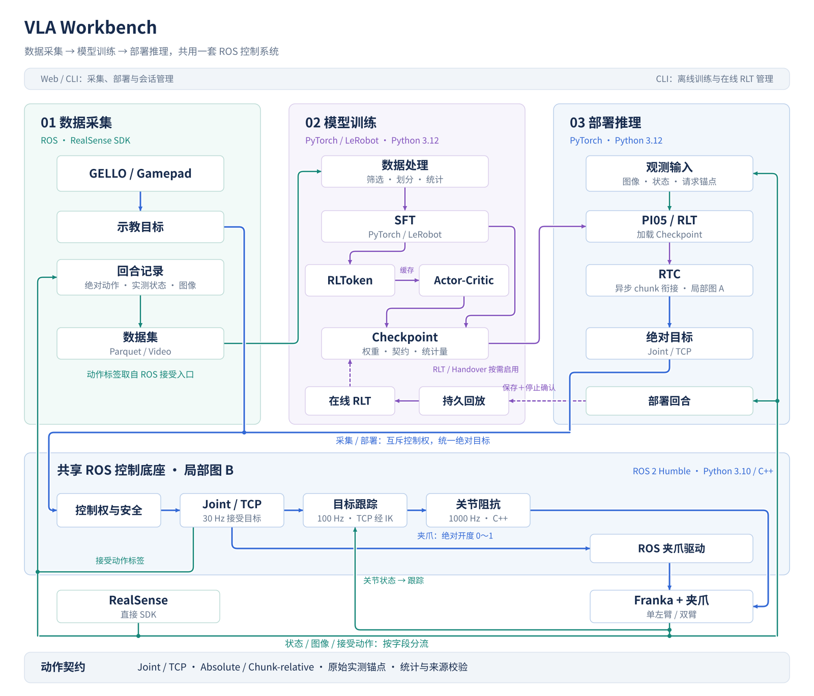
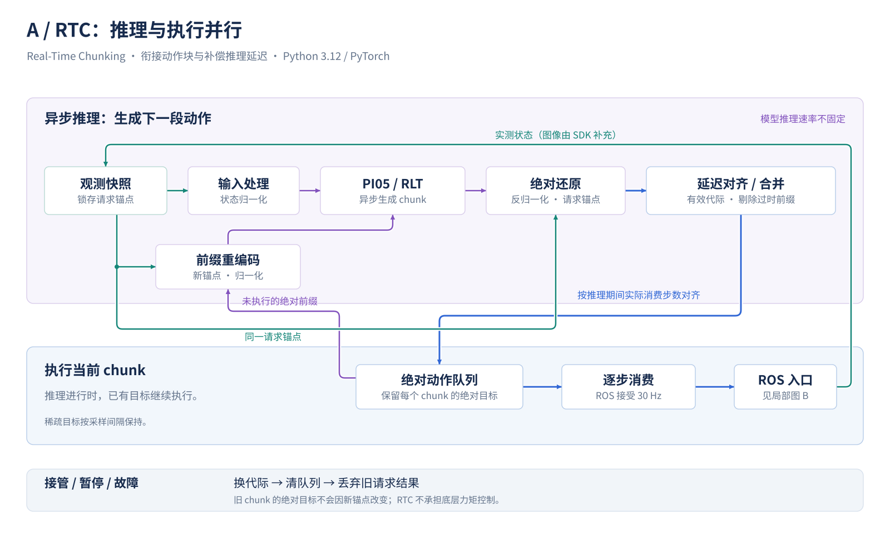
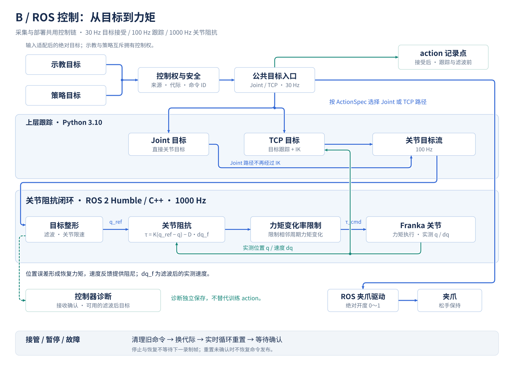

# VLA：Franka + PI0.5 + RLT

从 Evo-RLT 独立提取的 Franka 采集、训练和部署框架。采用官方 LeRobot 0.6.1，不包含 LeRobot fork、旧数据集、模型、tokenizer、回放数据库或训练结果。

## Workbench 整体架构

Workbench 分为 **数据采集 → 模型训练 → 部署推理** 三个部分。采集和部署共用一套 ROS 控制系统，训练通过数据集和 checkpoint 与两端衔接。部署回合经持久回放进入在线 RLT，更新后的 checkpoint 再用于推理。



[查看 SVG 大图](docs/diagrams/workbench.svg) · [下载 / 编辑 draw.io 源文件](docs/diagrams/workbench.drawio)

蓝色为控制命令，绿色为观测与记录，紫色为学习与模型；虚线表示可选更新或诊断链路。圆点表示共用主干的汇合或分叉，没有圆点的交叉不表示连接。共享数据通路按字段分流：记录器保存接受动作、实测状态与图像，模型读取所需观测，跟踪器读取关节状态；RealSense 图像直接来自 SDK。

<details>
<summary>局部图 A：RTC——推理与执行并行</summary>

RTC（Real-Time Chunking）在当前动作块执行期间异步生成下一块，按推理期间实际消费的步数对齐并衔接队列。每次请求锁存原始实测锚点，模型输出还原为绝对目标后入队；未执行前缀用于新请求时，必须按新锚点重新编码和归一化。推理速率不固定，ROS 目标接受为 30 Hz，稀疏目标按采样间隔保持。



[查看 RTC SVG 大图](docs/diagrams/rtc.svg) · [编辑源文件中的 RTC 页](docs/diagrams/workbench.drawio)

</details>

<details>
<summary>局部图 B：ROS——目标跟踪与关节阻抗闭环</summary>

示教与策略互斥拥有控制权，统一提交绝对 Joint／TCP 目标。关节路径直接提供关节目标，TCP 路径通过同一跟踪器与 IK；上层以 100 Hz 更新目标，C++ 关节阻抗控制器以 1000 Hz 根据位置误差和速度反馈生成力矩，并保留目标滤波、关节限速与力矩变化率保护。夹爪走独立的绝对开度通路。



训练 action 在公共入口接受后、跟踪与滤波前记录；控制器接收确认及可用的滤波后目标作为独立诊断保存。停止／重置必须等待确认，旧代际推理结果不能重新启用运动。

[查看 ROS 控制 SVG 大图](docs/diagrams/impedance.svg) · [编辑源文件中的 ROS Control 页](docs/diagrams/workbench.drawio)

</details>

检查架构时重点核对以下边界：

- **动作与标签**：joint 为 8D／臂，TCP 为 10D／臂，双臂按左、右拼接。Parquet 始终保存绝对目标与每臂 50D 原始实测状态；`absolute`／`chunk_relative` 是模型表示。相对化在归一化之前进行，使用 chunk 起点实测锚点，旋转通过矩阵组合，夹爪始终是绝对开度。
- **执行与控制权**：关节模式在公共关节入口记录；TCP 模式在公共 TCP 入口、平滑和 IK 之前记录。输入适配器与模型不能绕过协调器发布机械臂目标；接管、暂停、故障和回合边界使旧代际命令失效。目标接受为 30 Hz，上层跟踪为 100 Hz，C++ 关节阻抗控制为 1000 Hz。
- **进程与训练**：模型与 Web 使用 Python 3.12，ROS 采集与上层控制使用系统 Python 3.10，通过本地协议交换观测和绝对目标。ROS 进程不加载模型或 Torch，模型进程不直接控制硬件。Web 管理采集和推理会话，在线训练仍由终端入口管理；在线更新须先持久化回合并取得控制器停止确认。

| 架构职责                 | 主要实现位置                                                                                                                              | 检查入口                                                                                                           |
| ------------------------ | ----------------------------------------------------------------------------------------------------------------------------------------- | ------------------------------------------------------------------------------------------------------------------ |
| 动作契约、变换与统计     | [vla/actions](src/vla/actions/)                                                                                                           | [动作测试](tests/actions/)、[契约说明](docs/ROS_ACTION_CONTRACT.md)                                                |
| 共用会话与 Web           | [ros_session.py](src/vla/cli/ros_session.py)、[web/backends.py](src/vla/web/backends.py)、[vla/web](src/vla/web/)                         | [Web 测试](tests/web/)、[终端测试](tests/rlt/test_terminal.py)                                                     |
| 采集、输入适配与控制协调 | [collect_ros.py](src/vla/datacollection/franka_robotiq_rollout/collect_ros.py)、[vla/control/ros](src/vla/control/ros/)                   | [控制测试](tests/control/)、[模拟采集测试](tests/rlt/test_dual_gamepad_record.py)                                  |
| ROS 实时执行与启动       | [关节阻抗控制器](ros_ws/src/franka_fr3_arm_controllers/)、[ROS 工作空间](ros_ws/)                                                         | [ROS 导入检查](scripts/check_ros.py)、[启动链测试](tests/rlt/test_teleop_entrypoints.py)                           |
| 数据处理、模型与 RTC     | [processing.py](src/vla/datacollection/processing.py)、[LeRobot 适配层](src/vla/adapters/lerobot/)、[vla/deployment](src/vla/deployment/) | [数据处理测试](tests/rlt/test_dataset_processing.py)、[RTC 测试](tests/rlt/test_rlt_ac_rtc.py)                     |
| 在线 RLT 与持久回放      | [online_training.py](src/vla/core/online_training.py)、[online_replay.py](src/vla/core/online_replay.py)                                  | [在线一致性测试](tests/rlt/test_online_consistency.py)、[稀疏动作时序测试](tests/rlt/test_sparse_action_timing.py) |

维护约定：用 draw.io 打开 `docs/diagrams/workbench.drawio`，编辑对应页并保存，再按下表分别导出 SVG（嵌入图表数据并保留白色背景）。README 默认展示总览，两张局部图默认折叠。

| draw.io 页  | SVG 文件                                     | 内容                              |
| ----------- | -------------------------------------------- | --------------------------------- |
| Overview    | [workbench.svg](docs/diagrams/workbench.svg) | 三个业务阶段、共享 ROS 与在线更新 |
| RTC         | [rtc.svg](docs/diagrams/rtc.svg)             | 推理／执行并行、锚点与队列衔接    |
| ROS Control | [impedance.svg](docs/diagrams/impedance.svg) | 目标跟踪、关节阻抗与记录点        |

修改模块边界、解释器归属、控制权、动作记录点或训练数据流时，同步更新对应图与定位表。离线验证和实机待验收范围见 [ROS 验收报告](docs/ROS_VALIDATION.md)。

## 本机使用

```bash
conda activate vla
cd /data0/sht/VLA-Workbench
source scripts/model_env.sh
vla-web --root "$VLA_ROOT"
```

访问 `http://127.0.0.1:8765`。启动 Web 服务本身不连接设备；在页面检查配置并创建会话后才启动对应后端。已有采集会话运行时不要重复启动硬件或修改其安装环境。

本机环境已安装 wheel；`source scripts/model_env.sh` 会将当前工作副本的 `src` 加入 Python 搜索路径。项目使用官方 LeRobot，不会自动读取其他 LeRobot checkout。独立开发副本的使用方式见下方「开发与验证」。

## 从代码重新安装

```bash
conda env create -f environment.yml
conda activate vla
python -m pip install -r requirements.lock
python -m pip install --no-deps '.[lerobot,franka,test]'
source scripts/model_env.sh
```

`requirements.lock` 固定本次实际验证的 Python 依赖。需要复现本机 Conda 原生包时，用 `conda create -n vla --file conda-linux-64.lock` 替代第一行。模型环境为 Python 3.12；ROS 使用系统 Python 3.10。

## Web 采集、数据处理与部署面板

```bash
python -m pip install -r requirements-web.lock
python -m pip install --no-deps '.[web]'
```

以下两种启动方式二选一，不能同时占用同一端口：

```bash
# 无硬件采集／部署演示
vla-web --demo --root "$VLA_ROOT"

# 真实采集／部署，需要完成设备配置；部署还需要本地模型资源
vla-web --root "$VLA_ROOT"
```

面板导航依次为「数据采集 → 数据处理 → 推理部署」，支持明暗主题、左右列拖动和错误一键复制：

- **采集**：单左臂／双臂 × GELLO／gamepad；保存完整状态，支持按后端能力录制、保存、丢弃及人工交接。相机角色使用 RealSense SDK 序列号，下拉额外显示型号；可选 Side 视角。Gamepad 可配置 TCP 工作空间，各采集路线可保存带备注的机械臂姿态并在待命时受控恢复。
- **处理**：离线逐帧查看多视角、状态和动作，全局选择状态字段，手动剔除完整回合，转换到新数据集。不会修改源数据；真实硬件会话运行期间不能启动转换。
- **部署**：VLA／RLT／自动模式按模型能力开放，支持 GELLO／gamepad 人工接管和回合记录。Web 不管理在线训练。
- **监控**：采集预览目标每视角 30 FPS，部署 10 FPS；显示实际服务端预览帧率和过期状态。预览设置不改变数据集帧率或控制频率，曲线可按物理量选择显示。

Demo 的采集／部署不连接硬件，也不生成真实采集数据集；**数据处理页即使在 Demo 下仍读取本地数据并写入真实转换结果**。浏览器关闭不结束独立 runner 中的会话。软件暂停不是硬件急停，各后端暂停对未保存回合的影响见 [Web 面板说明](docs/WEB_PANEL.md)。姿态库位于忽略目录 `runtime/web/poses.json`，应单独备份。

服务仅监听本机。远程访问使用 SSH 隧道，例如 `ssh -N -L 8765:127.0.0.1:8765 用户@机器人主机`。操作细节见 [Web 面板说明](docs/WEB_PANEL.md)、[离线数据处理](docs/DATA_PROCESSING.md)；当前验收结果见 [ROS 离线验收](docs/ROS_VALIDATION.md)，历史证据见 [Web 验收](docs/web/VALIDATION.md)。

## 专用 ROS 工作空间

在单独终端操作，不激活模型环境：

```bash
cd /data0/sht/VLA-Workbench
/usr/bin/python3 scripts/fetch_ros.py
bash scripts/install_ros_python.sh
bash scripts/build_ros.sh
source scripts/ros_env.sh
CHECK_ONLY=1 bash scripts/franka/start_teleop_single_left.sh
CHECK_ONLY=1 bash scripts/franka/start_teleop_duo.sh
```

系统前提是 ROS 2 Humble、MoveIt/ros2_control、Robotiq description/controllers、Joy、PyKDL，以及本机 `/opt/openrobots` 的原生依赖。Dynamixel SDK、串口库和 ROS 采集用的 NumPy/OpenCV/相机等依赖安装在 `ros_ws/python_deps`，版本固定在 `ros_ws/requirements-python.lock`；不改动系统 Python，也不引入模型 Conda 环境。版本快照见 `ros_ws/system-packages.lock`；第三方源码精确提交见 `ros_ws/dependencies.repos`。本轮没有安装或更改系统 ROS。

`CHECK_ONLY=1` 只校验配置；真实启动必须显式传入 `--execute`。所有路线由同一个 ROS 协调器管理控制权，不再提供可运行的 Franky 后端。旧配置需显式迁移。

## 功能入口

| 功能                                           | 入口                                                                                             |
| ---------------------------------------------- | ------------------------------------------------------------------------------------------------ |
| 单臂手柄完整 50D 采集（旧 31d 入口同样写 50D） | `scripts/franka/start_gamepad_record_single_left.sh` / `start_gamepad_record_single_left_31d.sh` |
| 双臂 gamepad 采集                              | `scripts/franka/start_gamepad_record_dual.sh`                                                    |
| 单／双臂 GELLO 遥操作及采集流程                | `scripts/franka/start_teleop_single_left.sh` / `scripts/franka/start_teleop_duo.sh`              |
| Web 离线预览 / 回合筛选                        | `vla-web` → 数据处理；[使用说明](docs/DATA_PROCESSING.md)                                        |
| 特征处理 / SFT 划分                            | `vla-extract-dataset-features` / `vla-prepare-franka-sft-split`                                  |
| PI0.5 SFT / RLToken                            | `vla-train-franka-pi05-sft` / `vla-train-rl-token`                                               |
| 离线缓存 / Actor-Critic                        | `vla-build-transition-cache-v2` / `vla-train-actor-critic`                                       |
| Handover                                       | `vla-build-handover-cache` / `vla-train-handover`                                                |
| RTC 部署 / 采集客户端                          | `vla-deploy-franka-pi05-rtc` / `vla-collect-franka`                                              |
| SFT 服务 / RLT 服务                            | `vla-serve-franka-sft` / `vla-serve-franka-rollout`                                              |
| 在线 RLT / 恢复                                | `vla-serve-franka-rollout --online-*`；恢复使用 `--online-resume`                                |
| 训练语义升级                                   | `python -m vla.cli.upgrade_rlt_training --help`                                                  |

详细用法见 [操作说明](docs/WORKFLOWS.md)、[迁移对照](docs/migration/FEATURES.md) 和 [验收记录](docs/migration/VALIDATION.md)。

## 数据集分层

`datasets/raw/` 存放人工原始采集，`sft/` 存放训练输入，`transitions/` 存放 transition cache，`rollouts/` 存放部署回合，`online/` 预留在线数据。目录骨架由 Git 管理，数据内容忽略。Web 自动预填相对输出路径，按采集配置调整；详见 [目录与命名说明](datasets/README.md)。

完整原始状态为 **50D／臂、双臂 100D**，包含 TCP 位姿、夹爪实测开口、TCP 外力／外力矩估计、TCP 速度、关节位置／力矩／外部力矩估计／速度。`action` 按采集选择为 joint 8D／16D 或 TCP 10D／20D，始终是绝对目标。先保存完整状态，再按训练需求提取；旧 `_31d` 入口同样写完整 50D。旧 29D／31D／58D 数据不能续采新格式，仍可离线读取和提取。字段、单位及转换示例见 [采集格式说明](docs/DATA_COLLECTION_FORMAT.md)。

## 训练与评估产物

`outputs/` 按 `sft / rltoken / ac / handover / online / eval` 分层，建议使用 `<阶段>/<task_id>/run-<编号>/`。仅目录骨架和说明进 Git，实际权重、日志和报告忽略。用途、训练输出参数及与数据目录的边界见 [产物目录说明](outputs/README.md)。

## 配置、数据与 Git

设置 `VLA_ROOT` 指定可写工作目录；默认 Python 数据目录基于当前目录，源码脚本默认使用仓库根目录。安装包中的配置通过 `vla.paths.resource()` 定位，运行产物放在 `runtime/`、`datasets/`、`outputs/` 等忽略目录。

配置中的设备编号和网络地址必须按现场核对，不按枚举顺序推断视角。旧部署 home 配置默认关闭，启用时必须提供通过校验的目标；Web 采集前姿态库是另一个显式操作流程，保存 TCP 位姿、不包含夹爪状态。旧数据格式中的 `evo_rlt` 元数据字段保留，以维持格式兼容；额外字段同时保存到 `meta/vla_metadata.json`。

本仓库独立维护，当前开发分支为 `ros-dev`。配置远端和推送须由用户明确请求。原采集仓库与已有环境不修改。数据、权重、tokenizer、回放、日志和第三方源码／构建产物不进入 Git。

## 开发与验证

按改动范围选择测试与精简记录见 [测试指南](tests/README.md)。

在要测试的工作副本中显式设置根目录，避免继承原采集目录的环境变量：

```bash
conda activate vla
export VLA_ROOT="$PWD"
export VLA_PYTHON="$CONDA_PREFIX/bin/python"
source scripts/model_env.sh
# 优先运行本次修改涉及的测试
bash scripts/test.sh -q tests/web
# 集成检查时运行完整离线回归
bash scripts/test.sh -q
```

测试脚本禁用外部 pytest 插件自动加载并启用模型离线模式。缺少真实 checkpoint 的跳过项不算通过；模拟设备和合成数据的结果不等于实机验收。不要在测试中启动或移动机器人。

开发副本可通过 `source scripts/model_env.sh` 直接使用本副本源码，无需重新安装到正在采集的共享环境。需要更改依赖或安装方式时使用独立开发环境；不要把活动环境的 editable 安装指向开发副本。仅查看新界面时使用独立工作目录和端口，例如 `python -m vla.web.app --demo --root "$VLA_ROOT" --port 8766`；不要关联原目录的 runner、数据或 ROS install。

Python 项目沿用 Apache-2.0 声明；迁入 ROS 文件保留各自许可，其中 GELLO 包使用 MIT，个别驱动/launch 文件保留原 BSD 等许可。
